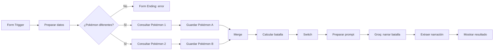

# ⚡ Batalla Pokémon con n8n y Groq

Workflow de [n8n](https://n8n.io) que enfrenta a dos Pokémon, calcula quién gana según sus estadísticas y usa inteligencia artificial (Groq) para narrar la batalla en español.

## ¿Cómo funciona?

1. El usuario abre un formulario y elige dos Pokémon y un estilo de narración.
2. El flujo valida que los dos Pokémon sean diferentes.
3. Consulta la [PokéAPI](https://pokeapi.co) para obtener las estadísticas de cada uno.
4. Calcula el poder de cada Pokémon con la fórmula:

   ```
   poder = ataque × 2 + defensa + velocidad
   ```

5. Decide el ganador, o empate si los poderes son iguales.
6. Envía un prompt a la API de Groq para que narre la batalla en 100 a 150 palabras, respetando el resultado.
7. Muestra al usuario una pantalla final con el ganador, los poderes y la narración.

## Diagrama del flujo



## Nodos del workflow

| Nodo | Tipo | Función |
|------|------|---------|
| Form Trigger | Form Trigger | Formulario con tres listas: `pokemon1`, `pokemon2` y `estilo` |
| Preparar datos | Edit Fields | Limpia los nombres (quita espacios y pasa a minúsculas) |
| ¿Pokémon diferentes? | If | Verifica que no se elija el mismo Pokémon dos veces |
| Form Ending | Form | Muestra un mensaje de error si los Pokémon son iguales |
| Consultar Pokémon 1 / 2 | HTTP Request | Obtienen los datos de cada Pokémon desde la PokéAPI |
| Guardar Pokémon A / B | Edit Fields | Guardan cada respuesta como `pokemonA` y `pokemonB` |
| Merge | Merge | Junta los dos Pokémon en un solo item (por posición) |
| Calcular batalla | Code | Calcula el poder de cada Pokémon y define el ganador |
| Switch | Switch | Clasifica el resultado: gana Pokémon 1, gana Pokémon 2 o empate |
| Preparar prompt | Edit Fields | Arma las instrucciones para la IA |
| Groq: narrar batalla | HTTP Request | Llama a la API de Groq (modelo `openai/gpt-oss-120b`) |
| Extraer narración | Code | Obtiene el texto de la IA y arma el título y el mensaje final |
| Mostrar resultado | Form (Form Ending) | Muestra el resultado al usuario |

## Opciones del formulario

| Campo | Opciones |
|-------|----------|
| `pokemon1` | pikachu, bulbasaur, squirtle, eevee |
| `pokemon2` | charmander, bulbasaur, squirtle, eevee |
| `estilo` | epico, gracioso, dramatico |

## Requisitos

- Una instancia de n8n (en la nube o local).
- Una API key de Groq. Se crea gratis en [console.groq.com](https://console.groq.com) → API Keys.

## Instalación

1. Descarga el archivo `Batalla Pokémon.json` de este repositorio.
2. En n8n, abre el menú **⋯** → **Import from File** y selecciona el archivo.
3. Configura tu credencial de Groq:
   - Abre el nodo **Groq: narrar batalla**.
   - En **Authentication** debe estar **Generic Credential Type** → **Bearer Auth**.
   - Crea una credencial nueva y pega tu API key en **Bearer Token** (solo la key, sin escribir `Bearer`).
4. Guarda el workflow y actívalo con el interruptor **Active**.
5. Abre el nodo **Form Trigger**, copia la **Production URL** y ábrela en el navegador.

## Uso

Elige un Pokémon en cada lista y un estilo de narración, y envía el formulario. En unos segundos verás quién ganó y la narración de la batalla. Si eliges el mismo Pokémon en las dos listas, el formulario te pedirá elegir Pokémon distintos.

### Ejemplo

| Pokémon | Ataque | Defensa | Velocidad | Poder |
|---------|--------|---------|-----------|-------|
| Pikachu | 55 | 40 | 90 | **240** |
| Charmander | 52 | 43 | 65 | **212** |

**Resultado:** GANADOR: PIKACHU

## Manejo de errores

- Si Groq falla, el nodo **Groq: narrar batalla** continúa el flujo (`Continue on error`) y la pantalla final muestra un mensaje de respaldo en lugar de la narración.
- Si los dos Pokémon son iguales, el flujo se detiene antes de consultar la PokéAPI y muestra un aviso.

## Solución de problemas

- **Error 401:** la API key de Groq no es válida o está mal configurada. Revisa que el Bearer Token no incluya la palabra `Bearer` ni espacios extra.
- **Referenced node doesn't exist:** el nombre del nodo dentro de `$('...')` en un nodo Code no coincide con el nombre real del nodo. Revisa mayúsculas, acentos y espacios.
- **El formulario no responde:** confirma que el workflow esté activo y que estés usando la Production URL.

## Seguridad

El archivo exportado **no incluye credenciales**, solo una referencia a ellas. Cada persona que use este workflow debe configurar su propia API key de Groq. Nunca escribas tu key directamente en un nodo ni la subas al repositorio.

## Tecnologías

- [n8n](https://n8n.io): automatización de flujos
- [PokéAPI](https://pokeapi.co): datos de Pokémon
- [Groq](https://groq.com): modelo de lenguaje para la narración
